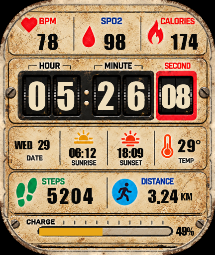
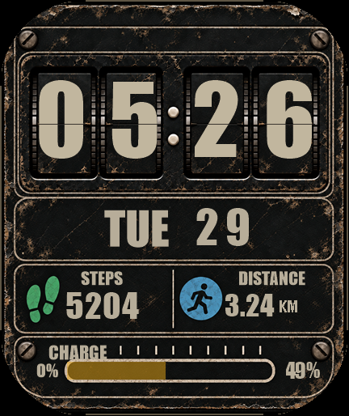

# Vintage Grunge Fitness

Zepp OS watchface for Amazfit Bip Max (432 × 514). Version 1.4.5.





## Project layout

- `assets/`: generated assets used by the watch.
- `watchface/`: watchface runtime.
- `artwork/`: source images and design references.
- `previews/`: rendered previews and visual checks.
- `scripts/`: asset generation, preview and build helpers.
- `references/`: display contour and revision baselines.
- `releases/`: original versioned Zepp packages.

## Build

Install Node.js and the official Zepp Zeus CLI, then run from the repository root:

```sh
zeus build -t "Amazfit Bip Max"
```

Asset generation uses Windows PowerShell and System.Drawing. Generated assets are already included. To regenerate them, run `./scripts/make-assets.ps1`. Run preview and validation commands from the repository root. Local Zeus wrappers require a configured local tool installation; the standard CLI command above works with an installed Zeus CLI.

## Releases

Published packages are available on the repository’s Releases page. Existing packages remain unchanged. GitHub publication is separate from Zepp store approval and installation. Preserve the registered numeric Zepp ID in `app.json` for in-place upgrades.
